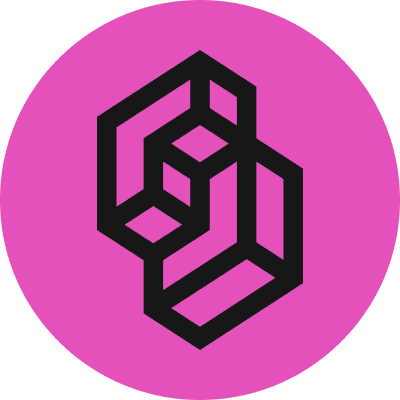
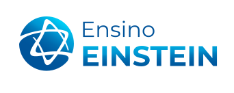
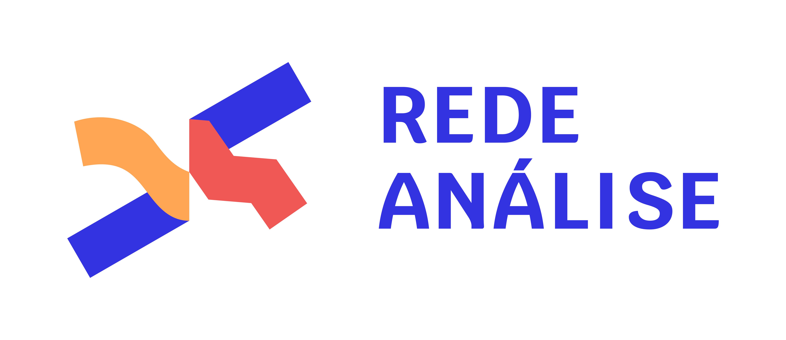
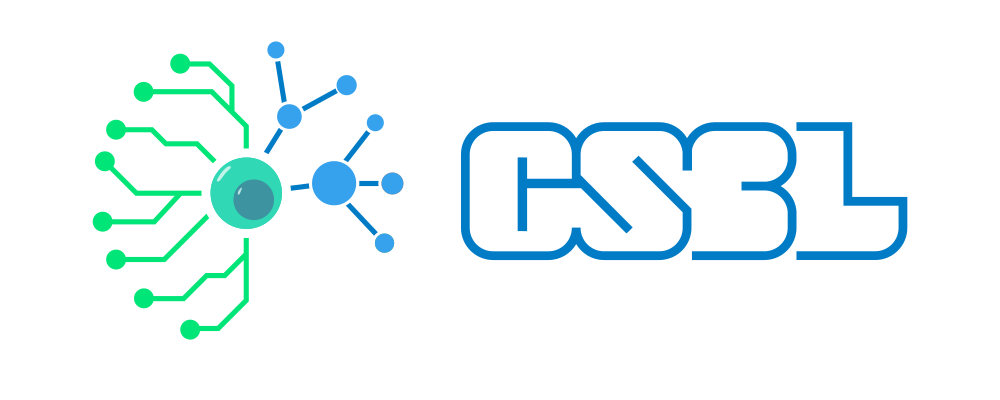

# Olá, sou Leonardo Rovatti 👋

**Biólogo e desenvolvedor · Dados, automação e IA aplicados à pesquisa científica**

[Sobre mim](#sobre-mim) · [Projetos](#projetos-e-iniciativas) · [Tecnologias](#tecnologias-e-ferramentas) · [Colaborações](#experiência-e-colaborações) · [Contato](#contato)

---

## Sobre mim

Desenvolvo ferramentas para apoiar a pesquisa, a análise de dados e o acesso ao conhecimento científico. Meu trabalho reúne **biologia, desenvolvimento de software e inteligência artificial** em aplicações web, fluxos de processamento de dados e automações. Também atuo com **divulgação científica**, tornando informações complexas mais acessíveis.

## Projetos e iniciativas

### 🦠 Detecta

Processamento e análise de informações para apoiar a **vigilância e a inteligência epidemiológica**.

**Frentes:** integração e análise de dados · epidemiologia · automação

### 💬 SabIA

Aplicações de **IA conversacional com consulta a fontes**, voltadas ao acesso a informações confiáveis.

**Frentes:** modelos de linguagem (LLMs) · recuperação de informação (RAG) · agentes de IA

### 📊 Análise da produção científica

Integração de **dados acadêmicos e bibliométricos** para analisar e visualizar a produção científica.

**Frentes:** ciência de dados · bibliometria · visualização

### ⚙️ Automação de fluxos de pesquisa

Integração de **ferramentas, documentos, APIs e modelos de IA** em fluxos de trabalho para a pesquisa.

**Frentes:** integração de sistemas · APIs · automação

> Parte dessas iniciativas é desenvolvida em ambientes institucionais ou privados e não possui repositório público.

## Tecnologias e ferramentas

### 🔬 Ciência de dados e computação científica

  
  

### 🤖 IA, LLMs e automação

  

#### ⚡ AI’s System One

  
  &nbsp;
  

<a href="https://typesafe.ai/">Jev · TypeSafe AI</a> &nbsp;·&nbsp; <a href="https://laya.convaiinnovations.com/">Laya</a>

### 💻 Desenvolvimento de aplicações

  

### ⚙️ Infraestrutura e versionamento

  

## Experiência e colaborações

<table width="100%">
  <tr>
    <td width="20%" align="center" valign="middle">
      
    </td>
    <td width="20%" align="center" valign="middle">
      
    </td>
    <td width="20%" align="center" valign="middle">
      
    </td>
    <td width="20%" align="center" valign="middle">
      
    </td>
    <td width="20%" align="center" valign="middle">
      
    </td>
  </tr>
  <tr>
    <td align="center"><a href="https://www.itps.org.br/">ITpS</a></td>
    <td align="center"><a href="https://ensino.einstein.br/">Ensino Einstein</a></td>
    <td align="center"><a href="https://schenberg.org.br/">Instituto Mario Schenberg</a></td>
    <td align="center"><a href="https://redeanalise.com.br/">Rede Análise</a></td>
    <td align="center"><a href="https://www.csbiology.org/">CSBL USP</a></td>
  </tr>
</table>

## Contato

Tenho interesse em parcerias que aproximem <strong>ciência, tecnologia e impacto social</strong>.

<table>
  <thead>
    <tr>
      <th>Oportunidade</th>
      <th>Como podemos colaborar</th>
      <th>Onde me encontrar</th>
    </tr>
  </thead>
  <tbody>
    <tr>
      <td><strong>🔬 Colaborações em pesquisa</strong></td>
      <td>Análise de dados científicos, bibliometria e inteligência epidemiológica.</td>
      <td align="center"><a href="http://lattes.cnpq.br/0433286394024806">Lattes</a></td>
    </tr>
    <tr>
      <td><strong>🤖 IA e automação</strong></td>
      <td>Agentes, consulta a fontes com RAG e integração de fluxos de trabalho.</td>
      <td align="center"><a href="https://github.com/leorovatti">GitHub</a></td>
    </tr>
    <tr>
      <td><strong>📚 Divulgação científica</strong></td>
      <td>Conteúdos e ferramentas para tornar o conhecimento científico mais acessível.</td>
      <td align="center"><a href="https://twitter.com/leorovatti">X (Twitter)</a></td>
    </tr>
  </tbody>
</table>

<table width="100%">
  <tr>
    <td valign="middle">
      <h3>✉️ Contato por e-mail</h3>
      
Para propostas profissionais, parcerias e assuntos de pesquisa.

    </td>
    <td align="center" valign="middle">
      
    </td>
  </tr>
</table>

---

<picture>
  <source media="(prefers-color-scheme: dark)" srcset="https://raw.githubusercontent.com/leorovatti/leorovatti/output/github-contribution-grid-snake-dark.svg" />
  <source media="(prefers-color-scheme: light)" srcset="https://raw.githubusercontent.com/leorovatti/leorovatti/output/github-contribution-grid-snake.svg" />
  
</picture>
